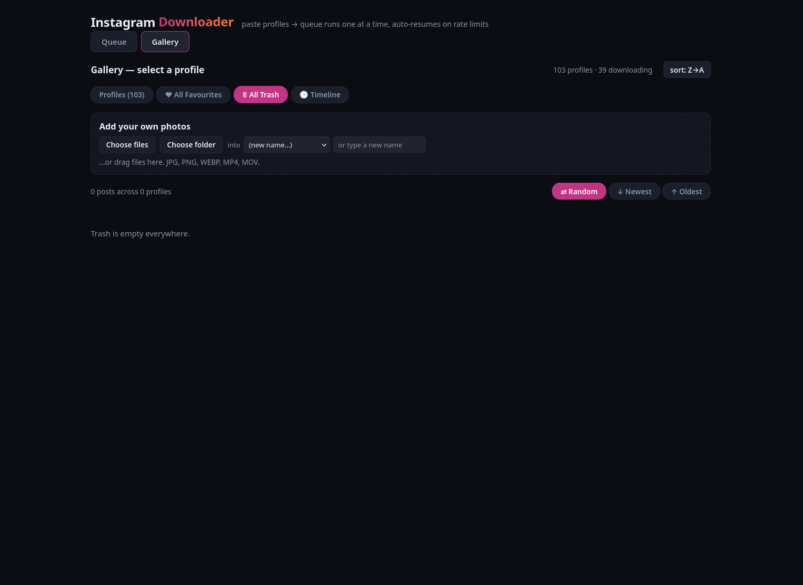
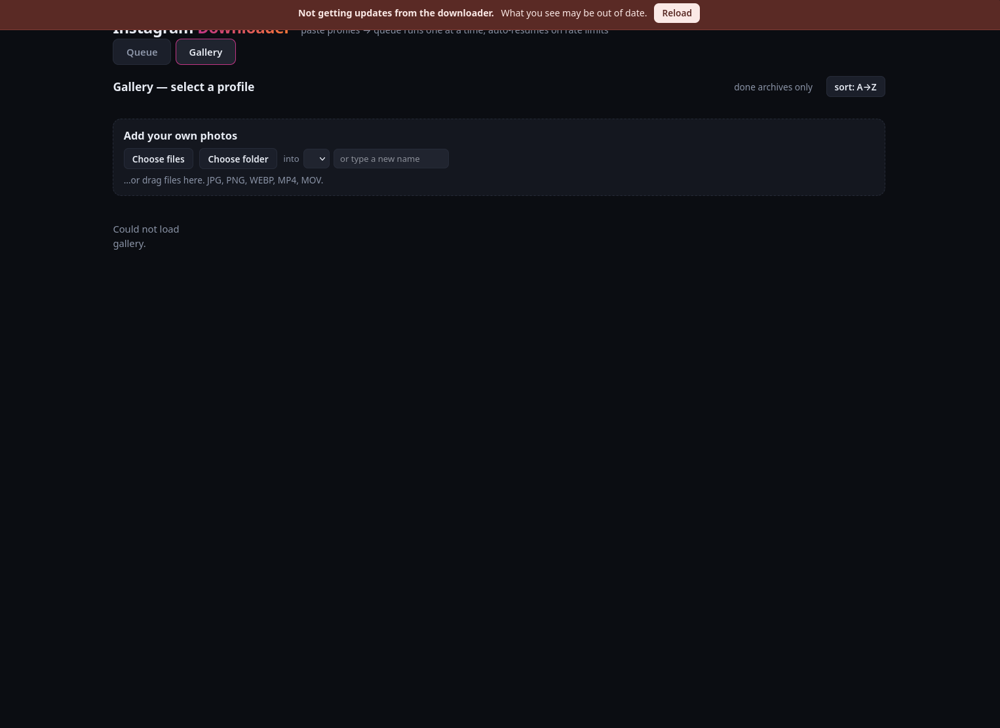

# Instagram Downloader

**A local web interface for [instaloader](https://instaloader.github.io/).**

This project is a frontend only. All downloading is done by
[instaloader](https://github.com/instaloader/instaloader) — the established
command-line tool (GPL-3.0, also on
[PyPI](https://pypi.org/project/instaloader/)). Nothing here reimplements it or
talks to Instagram directly: it builds instaloader's command line, runs it, and
gives you a queue and a gallery on top.

If you want to download one profile once, you do not need this — use
[instaloader on its own](https://instaloader.github.io/). This is for keeping a
larger archive over time, where you want a queue that survives reboots, sane
pacing, and a way to actually browse what you collected.

---

## Screenshots

**Queue** — paste profiles, add them, start. Everything downloads one at a time.


**Gallery** — every profile you have archived, plus archive-wide views, and a box
to add your own photos or folders to any profile.



Uploading from a phone or another computer works through the same browser page —
choose files or a folder, pick the destination profile, and they appear in that
profile's grid.



---

## Install and run

You need **Python 3.10+** and an **Instagram account**. Nothing else — no pip
packages to install yourself, no compiling, no config files to write.

```bash
git clone https://github.com/hardlysleeping/insta-desktop.git
cd insta-desktop
python3 run.py
```

That is the whole install. `run.py` creates a private Python environment in
`.venv/` next to itself, installs instaloader into it, starts the app and opens
your browser. Nothing touches the rest of your system and nothing needs `sudo`.
If instaloader is already installed it skips straight to starting.

First run takes ~20 seconds, mostly pip. After that it starts instantly.

Then:

1. **Log in** — click **Sessions** → **Auto-grab best session** picks up the
   Instagram login already in Firefox/Zen/LibreWolf, so you never type a password
   into this app. Or use username + password, which opens instaloader's own login
   in a terminal.
2. **Paste profiles** — one per line. `username`, `@username` and full
   `instagram.com` URLs all work.
3. **Add to queue**, press **Start**, and leave it running.

Downloads land in `~/instagram/<username>/` in instaloader's normal layout, so
instaloader itself can still read the folder.

### Other ways to start it

```bash
python3 run.py --service     # also set it up to start at login (Linux)
python3 run.py --no-install  # don't install instaloader, just run
python3 run.py --port 9000   # different port
./start.sh                   # if you already have instaloader on PATH
python3 server.py            # plain, standard library only
```

**Platforms:** the app is standard-library Python and runs on Linux, macOS and
Windows. Linux gets the extras (autostart service, desktop icon, GTK control
panel). On macOS/Windows everything in the web UI works the same, and
delete-for-good still goes to Trash / Recycle Bin.

Optional Linux extras:

```bash
./install-desktop-icon.sh     # launcher icon in your applications menu
python3 control-panel.py      # small window: start / stop / restart / copy link
```

The control panel needs PyGObject. Without it you get a plain terminal prompt
with the same commands (`start`, `stop`, `restart`, `status`, `open`, `quit`).
Closing the panel does **not** stop the app.

### Reach it from your phone

It listens on `127.0.0.1` by default. To use it from another device on your own
network or over Tailscale:

```bash
INSTA_HOST=0.0.0.0 python3 run.py
```

Then open `http://<machine-ip>:8765` — e.g. `http://100.x.y.z:8765` over
Tailscale, or `http://192.168.1.50:8765` on the same wifi. On Windows, `set
INSTA_HOST=0.0.0.0` first. For the systemd service, `systemctl --user edit
insta-downloader` and add `Environment=INSTA_HOST=0.0.0.0` under `[Service]`.

**There is no authentication** — the UI can start logins and delete files. Only
do this on a network you trust, never port-forwarded to the internet. The
browser-login button opens a terminal on the *server* machine, so login only
makes sense from the machine it runs on.

### Autostart (Linux)

```bash
./install-service.sh          # install + start, enabled at login
./install-service.sh remove   # stop + uninstall
systemctl --user status insta-downloader
journalctl --user -u insta-downloader -f
```

---

## How it works

Two pieces:

- **instaloader** makes every request to Instagram and writes the files. It is
  the only thing that talks to Instagram.
- **This app** is a queue and a viewer. It decides which profile runs next, runs
  instaloader for it, reads instaloader's output to show progress, and serves the
  gallery from the files on disk.

A job is one profile. Jobs run **one at a time**. State lives in
`~/.config/insta-desktop/state.json`, so closing the browser, restarting the app
or rebooting all keep the queue, its order and any cooldown. Only a profile that
was mid-download restarts from the beginning.

Re-running a profile does not re-download it. instaloader's `--fast-update` stops
at the first file it already has, and `--latest-stamps` records what has been
archived **outside** the media folder — so moving the archive to another drive
never causes re-downloads.

---

## Why the limits are there

This is the part people skip and then get blocked.

**Instagram rate-limits by IP.** Push too fast and you get HTTP 429, or their
anti-bot check (`feedback_required`), which in instaloader's output often appears
as a misleading `Profile <name> does not exist`. The account is fine; you are
being throttled. Retrying harder is what turns a temporary throttle into a real
block.

Three layers protect you:

1. **instaloader's own limiter.** It counts its requests and waits before
   exceeding roughly 275 GraphQL requests per 10 minutes, plus per-type windows.
   This app does not disable it.
2. **A gap between profiles** — 120 seconds by default. instaloader has no
   inter-profile delay of its own, and this app restarts it per profile, which
   resets that internal accounting. The gap stops a burst of logins back to back.
   Raising it is safer; lowering it to 0 will get you throttled.
3. **A whole-queue stop on 429.** If Instagram says stop, the entire queue waits
   — 15 minutes, or whatever retry it asks for — instead of hammering. This
   single behaviour matters more than any other for keeping an account usable.

The practical consequence: a large archive takes days, not hours. That is the
trade for not being blocked. If you need it faster, archive fewer profiles per
day rather than turning the delays off.

It also helps to not use an account you care about. A throwaway account for bulk
archiving is wise.

---

## What it is actually good for

- **Paste 200 profiles once and forget it.** They drain over days, and reboots or
  crashes don't lose the queue.
- **Know what happened.** Every job shows its status, how much it got, and the
  raw instaloader output when something failed.
- **Skip the re-downloads.** Re-run anything; only new posts come down.
- **Browse the whole archive.** A grid per profile, plus All Favourites and All
  Trash across every profile, and a merged timeline of every post you have,
  grouped by month with a slider.
- **Works on a phone.** Swipe through favourites full screen, tap to enlarge; on
  desktop the arrow keys walk post to post.
- **Multiple drives.** Keep old archives on one disk and send new downloads to
  another. Unplug a drive and its profiles drop out of the gallery until it is
  back; nothing is moved or copied without asking.
- **Your own photos too.** Any folder in an archive location appears as a
  profile, so non-Instagram pictures and phone uploads browse in the same grid.
- **Delete safely.** Trashing moves files to your desktop Trash and leaves a
  marker so instaloader doesn't fetch them again. Everything is recoverable.
- **Recoverable removals.** Removing a profile never loses it — restore it from
  the Removed list.
- **Reels as a separate pass.** Optionally queue reels as their own follow-up job
  instead of mixing them into the main download.

---

## The gallery

- **Profiles** — pick a person, see their posts as tiles. Videos play on hover.
- **♥ All Favourites** — everything you starred, across every profile, with a
  full-screen swipe view.
- **🗑 All Trash** — everything you set aside, with delete-for-good.
- **🕒 Timeline** — every post from every profile in one chronological stream,
  grouped by month, with a favourites-only filter.

On a tile: **♥** favourite, **⤢** open bigger, **🗑** trash. In the enlarged view:
**♡/♥**, **⤓** download (videos), **🗑**, and **‹ ›** to step through posts. On
desktop the arrow keys do the same, `f` favourites, `t` trashes, `d` downloads,
`Esc` closes. On a phone, swipe left/right to move and swipe down to close.

### Deleting for good

"Delete all trash" does two things, both deliberately recoverable:

1. It moves the files to your **desktop trash bin** (`~/.local/share/Trash`), so
   you can restore them from your file manager or empty the bin when you're sure.
2. It leaves a **0-byte placeholder** with the same filename in the profile
   folder. instaloader decides a post is already downloaded purely by whether
   that file exists, so the placeholder stops it fetching the post again.

Delete a file straight from your file manager instead, and the app notices the
next time it lists that profile and leaves the same kind of placeholder. Any post
marked this way can be un-marked in the UI, which removes the placeholder so it
downloads again on the next run.

---

## Settings worth knowing

All of instaloader's useful options are exposed in the UI, grouped, with a filter
box. Every field's tooltip shows the underlying instaloader flag.

| Setting | Default | Why |
| --- | --- | --- |
| Seconds between profiles | 120 | Keeps a burst of logins from looking automated |
| Only new posts | on | Re-runs skip what you already have |
| Remember what's archived | on | Works even if you move the folder |
| Stories / Highlights | on | Extra requests; the most common source of errors |
| Reels | off | Adds a separate reels-only pass per profile |

---

## Where things live

| Path | What |
| --- | --- |
| `~/instagram/<username>/` | Downloaded media (changeable, see below) |
| `~/instagram/<username>/.insta-index.json` | Hidden record of what was there, used to spot file-manager deletions |
| `~/.config/insta-desktop/state.json` | Queue, order, settings, cooldowns, deleted-post markers |
| `~/.config/instaloader/session-<user>` | Instagram session, created by instaloader |
| `~/.config/instaloader/latest-stamps.ini` | What has already been archived |
| `.venv/` (next to `run.py`) | The private environment `run.py` creates |

Override paths with `INSTA_OUTPUT` and `INSTA_STATE`; also honours `INSTA_PORT`
and `INSTA_HOST`.

### Choosing the downloads folder

In the app, click **Change…** on the Downloads folder card in Settings. Give a
full path, e.g. `/mnt/bigdrive/instagram`.

- Leave **Also move my existing archives into the new folder** unticked to send
  only *new* downloads to the new location. Your old files stay where they are
  and still show in the gallery, because the old folder stays in the archive
  list.
- Tick it to move every existing profile folder across in one go. It refuses if a
  folder with the same name already exists there, or while a download is running.

Because instaloader's `--latest-stamps` record lives outside the media folder,
moving or even deleting the whole tree never causes re-downloads — it still knows
what you already have.

---

## Honest limitations

- **Big archives are slow by design.** Days, not hours — the rate-limit trade
  above, not a bug.
- **Instagram fights this.** Even logged in, large profiles can hit limits
  partway through. The queue pauses and resumes; "everything in one sitting" is
  not guaranteed.
- **Sessions expire eventually.** Then every job fails until you log in again.
  The UI reports it rather than silently burning requests.
- **Stories and highlights are the flakiest part.** Instagram sometimes returns
  malformed data there and crashes instaloader; the job is marked done with a
  note instead of re-downloading everything.
- **Private profiles** only work if your account follows them.
- **No proxy support.** Per instaloader's own docs, cloud and VPN IPs tend to get
  *stricter* limits, not looser.
- **No authentication in the UI.** Treat it as a local tool.
- **The GTK control panel** needs PyGObject; without it you get a terminal prompt
  offering the same functions.

---

## Legal

Use this for content you have the right to download. Respect Instagram's Terms of
Service and the rights of the people whose content you are archiving.

## Licence

MIT — see [LICENSE](LICENSE). This project bundles no instaloader code;
instaloader is installed separately under its own licence (GPL-3.0).
