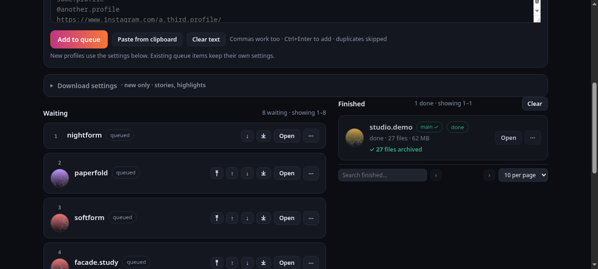
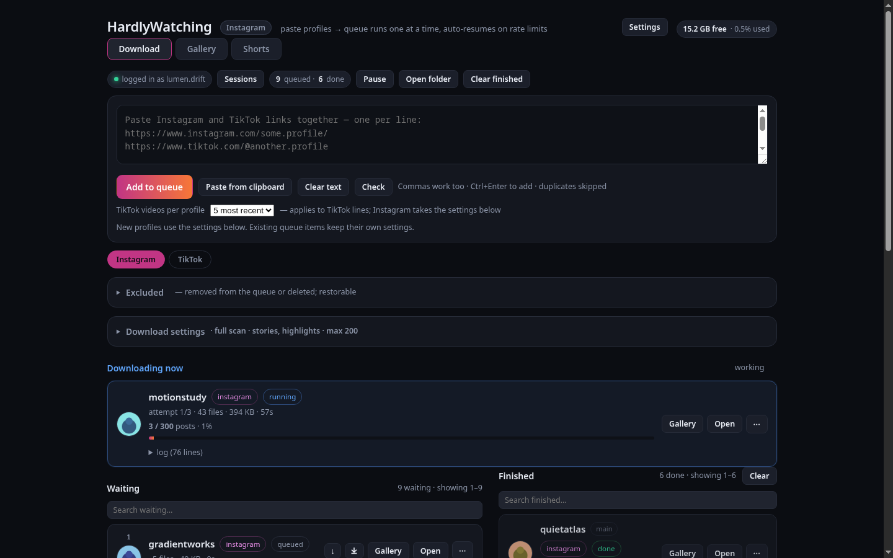
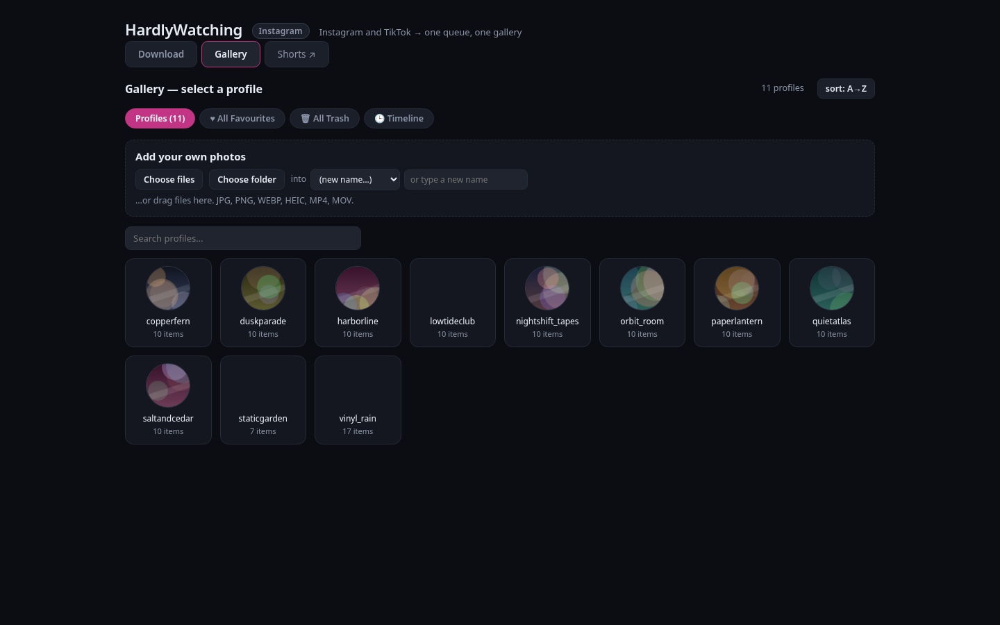
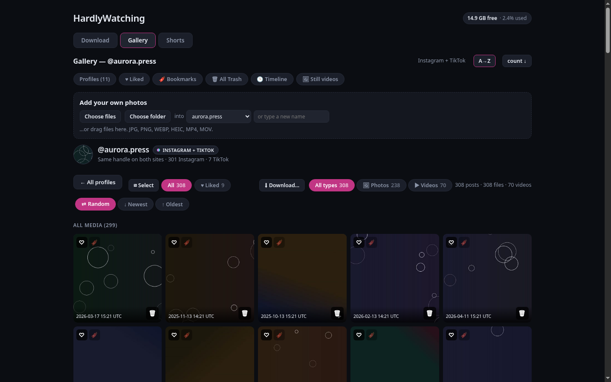
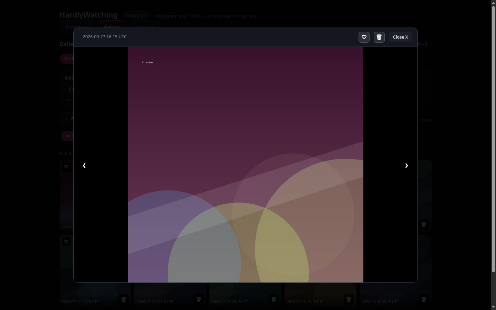
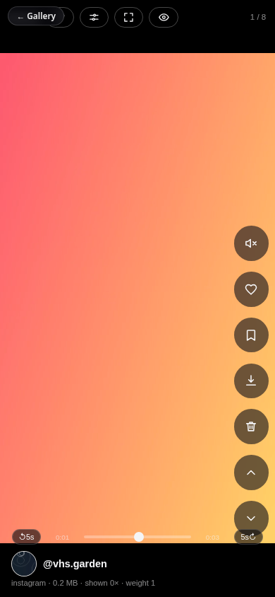
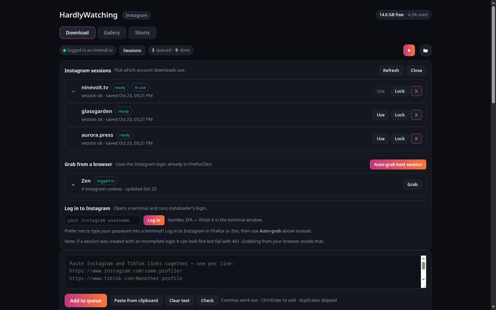

# HardlyWatching

### A self-hosted viewer and download queue for Instagram and TikTok

Paste the profiles you follow, let them download over days while you sleep, and
browse what you have collected in one place — grid, timeline, and a full-screen
short-video feed for your phone. Both platforms live in the same app behind one
queue and one gallery.

> ### It is a web UI for **[instaloader](https://instaloader.github.io/)** and **[yt-dlp](https://github.com/yt-dlp/yt-dlp)** — it has no downloader of its own.
>
> 
>
> Every file on disk is written by one of two separate, mature command-line
> tools, and this repository runs them:
>
> | what you download | the tool that does it | project |
> |---|---|---|
> | Instagram profiles | **instaloader** | [docs](https://instaloader.github.io/) · [PyPI](https://pypi.org/project/instaloader/) · [source](https://github.com/instaloader/instaloader) |
> | TikTok profiles | **yt-dlp** (with ffmpeg) | [docs](https://github.com/yt-dlp/yt-dlp#readme) · [PyPI](https://pypi.org/project/yt-dlp/) · [source](https://github.com/yt-dlp/yt-dlp) |
>
> This project adds a browser interface on top: a persistent queue, pacing, and a
> gallery. It reimplements neither downloader and never talks to Instagram or
> TikTok itself — it builds their command lines and runs them.
>
> **Want a downloader? Install [instaloader](https://instaloader.github.io/) or
> [yt-dlp](https://github.com/yt-dlp/yt-dlp).** If you have them and only want them,
> you don't need this project at all.
<br clear="left">

**What this adds:** paste 200 profiles once and let them drain over days, survive
reboots, and browse what you hoarded.

> **Use at your own risk.** Downloading at scale can get your IP blocked, rate
> limited, or your account banned. See [Use at your own risk](#use-at-your-own-risk).

---

## Screenshots

**Queue** — paste profiles, add them, start. Instagram and TikTok download in
parallel, one profile each, with the waiting list and finished list side by side.
Both page and search, so a queue of hundreds is still easy to navigate.



**TikTok** — the same download screen for TikTok, with per-profile controls for
how many videos to grab. Start with five, raise it later; only the missing ones
download.


**Downloading** — one profile runs at a time. The header names it while the rest
of the queue waits, and a pacing gap spaces runs out.



**Gallery** — every profile you have archived, marked while it is downloading, plus
archive-wide views and a box to add your own photos or folders.



**One profile** — its posts as a grid, filterable by media type and sorted however
you like.



**Timeline** — every post from every profile in one chronological stream, grouped
by month. The slider jumps between months; the two selectors pick a year and month
directly. Filter to just favourites if you want.


**Enlarged view** — click any post. Step through posts with the arrows (or the
arrow keys), favourite, download a video, or trash it.



**Shorts** — a full-screen, phone-sized feed of your reels and TikTok videos.
Swipe through it, like, trash, download, or change how often a clip comes back.
It is a separate tab in the header, and can be installed to a phone home screen.



**Sessions** — every saved Instagram login in one list, with the one in use marked.
Switch accounts with one click, or grab a login out of your browser so you never
type a password here.



---

## Install and run

You need **Python 3.10+** and an **Instagram account**. You do **not** need to
install instaloader yourself — `run.py` does it for you (see below).

```bash
git clone https://github.com/hardlysleeping/hardlywatching.git
cd hardlywatching
python3 run.py
```

That is the whole install. `run.py` creates a private Python environment in
`.venv/` next to itself, installs instaloader into it, starts the app and opens
your browser. Nothing touches the rest of your system and nothing needs `sudo`.
If instaloader is already installed it skips straight to starting.

First run takes ~20 seconds, mostly pip. After that it starts instantly.

Then:

1. **Log in** — click **Sessions**. See [Accounts and sessions](#accounts-and-sessions)
   below; the short version is one click to grab the login already in your browser.
2. **Paste profiles** — one per line. `username`, `@username` and full
   `instagram.com` URLs all work.
3. **Add to queue**, press **Start**, and leave it running.

Downloads land in `~/instagram/<username>/` in instaloader's normal layout, so
instaloader itself can still read the folder.

### Other ways to start it

```bash
cd hardlywatching            # enter folder location
python3 run.py --service     # also set it up to start at login (Linux)
python3 run.py --no-install  # don't install instaloader, just run
python3 run.py --port 9000   # different port
./start.sh                   # if you already have instaloader on PATH
python3 server.py            # plain, standard library only
```

**Platforms:** the app is standard-library Python and runs on Linux, macOS and
Windows. Linux gets the extras (autostart service, desktop icon, GTK control
panel). On macOS/Windows everything in the web UI works the same, and
delete-for-good still goes to Trash / Recycle Bin.

Optional Linux extras:

```bash
./install-desktop-icon.sh     # launcher icon in your applications menu
python3 control-panel.py      # small window: start / stop / restart / copy link
```

The control panel needs PyGObject. Without it you get a plain terminal prompt
with the same commands (`start`, `stop`, `restart`, `status`, `open`, `quit`).
Closing the panel does **not** stop the app.

### Reach it from your phone

It listens on `127.0.0.1` by default. To use it from another device on your own
network or over Tailscale:

```bash
INSTA_HOST=0.0.0.0 python3 run.py
```

Then open `http://<machine-ip>:8765` — e.g. `http://100.x.y.z:8765` over
Tailscale, or `http://192.168.1.50:8765` on the same wifi. On Windows, `set
INSTA_HOST=0.0.0.0` first. For the systemd service, `systemctl --user edit
hardlywatching` and add `Environment=INSTA_HOST=0.0.0.0` under `[Service]`.

**There is no authentication** — the UI can start logins and delete files. Only
do this on a network you trust, never port-forwarded to the internet. The
browser-login button opens a terminal on the *server* machine, so login only
makes sense from the machine it runs on.

### Autostart (Linux)

```bash
./install-service.sh          # install + start, enabled at login
./install-service.sh remove   # stop + uninstall
systemctl --user status hardlywatching
journalctl --user -u hardlywatching -f
```

**Start on login** can also be turned on or off from the app itself, under
*Download settings → App*. It sets the same systemd unit the commands above do,
so there is only ever one answer to whether it is enabled.

---

## How it works

Two pieces:

- **instaloader** makes every request to Instagram and writes the files. It is
  the only thing that talks to Instagram.
- **This app** is a queue and a viewer. It decides which profile runs next, runs
  instaloader for it, reads instaloader's output to show progress, and serves the
  gallery from the files on disk.

A job is one profile. **Instagram and TikTok each have their own worker**, so
one download per platform runs at a time and they run *alongside* each other.
They go through different programs to different servers with separate rate
limits, so neither waits for the other: a TikTok video starts in seconds even
when the Instagram queue is hundreds of profiles long, and an Instagram
rate-limit pause does not stop TikTok.

State lives in `~/.config/hardlywatching/state.json`, so closing the browser,
restarting the app or rebooting all keep the queue, its order and any cooldown.
Only a profile that was mid-download restarts from the beginning.

The sub-tabs split which queue you are *looking at*; the workers run regardless.
Start, Pause and Resume act on the platform on screen, so pausing Instagram to
sit out a block leaves TikTok downloading.

Re-running a profile does not re-download it. instaloader's `--fast-update` stops
at the first file it already has, and `--latest-stamps` records what has been
archived **outside** the media folder — so moving the archive to another drive
never causes re-downloads.

---

## TikTok

TikTok profiles download too, through **[yt-dlp](https://github.com/yt-dlp/yt-dlp)**
rather than instaloader. Same queue, same one-at-a-time worker, same gallery.

Pick TikTok on the Download tab and paste any of:

- the whole **Following accounts** page (`Ctrl+A`, `Ctrl+C`) — the usernames are
  found for you. Open it with **view all** next to Following accounts, then
  **scroll that list to the bottom** until it stops loading before you copy.
  Only the rows on screen exist in the page, so copying early grabs a fraction
  of your list. The app notices the mismatch and tells you if that happened
- plain handles, one per line
- `@handles` and profile URLs

**How many videos to grab is adjustable per profile, at any time.** Each TikTok
row in the queue has its own `−5 −15 [n] +5 +15 +25 all` control, counting back
from the newest video. Start with a few and raise it whenever you like — nothing
needs re-pasting.

**Raising the number only fetches what is new.** Each profile keeps its own
`.yt-dlp-archive.txt` listing what was already downloaded, so going from 5 to 50
fetches the 45 missing ones rather than 50 again. A profile that has finished can
be raised too: it returns to the queue and picks up where it left off.

The `n` is shown against the profile's own total, as `5 / 120`, so you can see
how much of someone you have not taken yet. Asking for more than exists just
means all of them.

There is no Instagram login involved: yt-dlp reads a public profile itself, which
is also why a **private** TikTok profile cannot be downloaded at all. Those show
in **red** next to the queue count rather than failing quietly.

The two platforms keep **separate folders** and never merge on disk. The gallery
groups them by label, so either side can be deleted or re-fetched without
touching the other.

### Excluded

Remove a profile from the queue — or delete it after downloading — and it is
remembered. Pasting your following list again will not add it back. It appears
under **Excluded** with the reason, and **Restore** puts it back in the queue.
Nothing is deleted by excluding; it is a memory, not a blacklist.

### yt-dlp options

Exposed in Settings, mapped to real flags: video quality rung, container, format
conversion, metadata/description/thumbnail files, embedded metadata and cover
art, request spacing, retries, rate limit, date window, cookies from a browser,
and proxy. Anything not listed there is not configurable.

About quality: TikTok only serves a few vertical renditions, and yt-dlp reports
height as the **long** side, so 1080p is 1080x1920. The setting takes the
familiar rung — 540, 720 or 1080 — rather than a pixel number.

---

### Posts that mix photos and videos

Instagram carousels often mix the two, and instaloader numbers every part in one
sequence whatever its type: a twenty-part post is `_1.jpg ... _16.jpg` then
`_17.mp4 ... _20.mp4`. Those parts belong to **one** post and are shown as one
tile with a `⧉ n` badge. Grouping them per file type split such a post in two,
which made a carousel look like a single image with the rest of it appearing
separately.

Files with no instaloader stamp — a phone upload, a saved image — are only
grouped when they really are parts: the unnumbered file must exist and the
numbered ones must run 2, 3, 4 with nothing missing. `IMG_0860.JPG` and
`IMG_0885.JPG` share a prefix but are different photos, so they stay separate.

### Videos that are really a still image

Many Instagram stories are several seconds of one unchanging image, stored as
video. `tools/static_videos.py` finds them by measuring — it samples each clip's
frames, downscales them, and checks how much they differ from the first. It is a
maintenance tool you run by hand, not part of the app:

**In the app:** the Gallery has a **🖼 Still videos** button in its toolbar. It
opens a small panel with **Scan stories** and **Scan all videos**. The scan runs
in the background with live progress ("checked 400 of 12,028") and a **Stop**
button, because decoding an archive takes far longer than a page can wait. When
it finishes it lists what it found and what it saved, and offers **Write still
images** — that writes the images for what has already been found, without
decoding everything a second time.

**Deleting.** The panel has **Delete videos** (removes the videos, keeps the
still images — one picture instead of a 30-second clip of one picture) and
**Delete both**. Each row in the findings list also has its own pair of buttons,
so one clip you want gone does not need the batch. Deleted files go to the
desktop trash, so a mistake is recoverable, and a 0-byte placeholder is left in
each one's place because instaloader treats "the file exists" as "already
downloaded" — without it the next run fetches the clip again and the deletion
undoes itself.

**From the command line**, the same work:

```sh
python3 tools/static_videos.py --stories-only          # report only
python3 tools/static_videos.py --stories-only --convert # also write a still
```

`--convert` writes a JPEG **beside** each clip, named `<date>_still.jpg`. It never
changes, moves or deletes a video, and re-running it cannot overwrite anything —
a name already taken gets a number instead. The still is taken from the middle of
the clip rather than the start, because a story often opens on a black frame.

Deciding how: frames are compared after downscaling to 16×16 grey, by mean pixel
difference from the first frame. Counting distinct frames does **not** work here —
compression noise makes every frame of a still image differ in bytes, so that
reports motion on a frozen clip. Real footage scores 63–70 on this measure,
static clips 0.000–1.9.

## Shorts

**Shorts** is a tab in the header, next to Download and Gallery — a phone-shaped,
full-screen feed of downloaded videos. Swipe or use the arrow keys. Each clip
has **like**, **trash**, **download**, **more** and **less**.

On a desktop there is a **seek bar** under the clip, and **← / →** jump five
seconds. Every clip loops, so without those there is no way back to the start.

Clips start **muted**, because a browser will not autoplay a video with sound —
which is what used to leave every clip sitting frozen at 0:00. Turn sound on with
the speaker button in the rail (or **m** on a desktop) and the choice is kept for
the rest of the sitting, so clips you scroll to later are not silent again.

Skips come in **5, 10 or 15 second** steps, starting at 5. Tap either skip
button — the **↺5s** and **5s↻** at the ends of the seek bar — three times to step
through them; the label and the buttons update to show the new step, and cycling
never throws the clip around. A single tap on a button skips by the current step,
and so do **← / →**. Two taps on a button skip twice the step.

On a phone, where there is no seek bar and no keyboard, **double-tap the left or
right half** of a clip to jump by the current step either way; a single tap plays
and pauses. A brief play or skip mark flashes over the clip either way, since
there is no visible control to move.

**One limitation, told plainly:** iOS will not let a clip that scrolls into view
play sound unless you have tapped that page, so if a clip refuses to start with
sound on it falls back to muted and the speaker button flips to say so — rather
than showing sound as on over a silent video. On desktop the sound setting simply
holds.

`/shorts` also works on its own, which is what the installable phone app uses.
The tab is the same player in a frame, so the two can never drift apart.

It is deliberately random with repetition, so the same clip can come back.
**More** and **less** change how often a **profile** reappears rather than
hiding anything: judge the person, not the one clip. One video landing well
means you want more from them, and every clip they posted follows.
**Favourites** filters to liked clips.

The order is reshuffled each time you reload the page or scroll back to the top,
so the feed does not start the same way twice. Switching tabs, backgrounding the
app or letting the phone sleep is **not** a new session — it carries on where you
left off, and only closing it starts over.

**It shows reels, not every video.** Every TikTok clip belongs in the feed,
since short-form is all TikTok is. For Instagram it shows reels and nothing
else: ordinary profile videos and IGTV are left out.

Which posts are reels comes from Instagram, through the JSON instaloader writes
beside each one. A video **you uploaded** has no such file, because Instagram
never served it — so for those the shape is measured instead, with `ffprobe`
(part of ffmpeg, already needed for TikTok). A video taller than it is wide is
short-form shaped and joins the feed; square and landscape do not. Measuring
costs about 140 ms a file, so the answer is stored next to the clip and reused
until the file itself changes — the first scan after an upload is slower, every
one after it is not.

Which posts are reels is read from instaloader's own record for each post
(`is_reel_media` in the saved `.json`), not guessed from the file or the length.
That works on an archive you already have — nothing needs re-downloading — and
carousel slides (`_2`, `_3`…) are matched to their post, so a multi-video reel
does not go missing. A video whose post record is absent is left out rather
than assumed to be a reel.

Videos start **muted**, because browsers block autoplay with sound. Tap a clip to
play or pause it.

Add it to your home screen and it runs as an app.

---

## Why the limits are there

This is the part people skip and then get blocked.

**Instagram rate-limits by IP.** Push too fast and you get HTTP 429, or their
anti-bot check (`feedback_required`), which in instaloader's output often appears
as a misleading `Profile <name> does not exist`. The account is fine; you are
being throttled. Retrying harder is what turns a temporary throttle into a real
block.

Three layers protect you:

1. **instaloader's own limiter.** It counts its requests and waits before
   exceeding roughly 275 GraphQL requests per 10 minutes, plus per-type windows.
   This app does not disable it.
2. **A gap between profiles** — 120 seconds by default. instaloader has no
   inter-profile delay of its own, and this app restarts it per profile, which
   resets that internal accounting. The gap stops a burst of logins back to back.
   Raising it is safer; lowering it to 0 will get you throttled.
3. **A whole-queue stop on 429.** If Instagram says stop, the entire queue waits
   — 15 minutes, or whatever retry it asks for — instead of hammering. This
   single behaviour matters more than any other for keeping an account usable.

The practical consequence: a large archive takes days, not hours. That is the
trade for not being blocked. If you need it faster, archive fewer profiles per
day rather than turning the delays off.

It also helps to not use an account you care about. A throwaway account for bulk
archiving is wise.

---

## What it is actually good for

- **Paste 200 profiles once and forget it.** They drain over days, and reboots or
  crashes don't lose the queue.
- **Know what happened.** Every job shows its status, how much it got, and the
  raw instaloader output when something failed.
- **Skip the re-downloads.** Re-run anything; only new posts come down.
- **Browse the whole archive.** A grid per profile, plus All Favourites and All
  Trash across every profile, and a merged timeline of every post you have,
  grouped by month with a slider.
- **Works on a phone.** Swipe through favourites full screen, tap to enlarge; on
  desktop the arrow keys walk post to post.
- **Multiple drives.** Keep old archives on one disk and send new downloads to
  another. Unplug a drive and its profiles drop out of the gallery until it is
  back; nothing is moved or copied without asking.
- **Your own photos too.** Any folder in an archive location appears as a
  profile, so non-Instagram pictures and phone uploads browse in the same grid.
- **Delete safely.** Trashing moves files to your desktop Trash and leaves a
  marker so instaloader doesn't fetch them again. Everything is recoverable.
- **Recoverable removals.** Removing a profile never loses it — restore it from
  the Removed list on the Instagram side.
- **Reels as a separate pass.** Optionally queue reels as their own follow-up job
  instead of mixing them into the main download.

---

## The gallery

- **Profiles** — pick a person, see their posts as tiles. Videos play on hover.
- **♥ All Favourites** — everything you starred, across every profile, with a
  full-screen swipe view.
- **🗑 All Trash** — everything you set aside, with delete-for-good.
- **🕒 Timeline** — every post from every profile in one chronological stream,
  grouped by month, with a favourites-only filter.

On a tile: **♥** favourite, **⤢** open bigger, **🗑** trash. In the enlarged view:
**♡/♥**, **⤓** download (videos), **🗑**, and **‹ ›** to step through posts. On
desktop the arrow keys do the same, `f` favourites, `t` trashes, `d` downloads,
`Esc` closes. On a phone, swipe left/right to move and swipe down to close.

### Profile pictures and thumbnails

Tile images **fill in as you download**, not all at once:

- The first time a profile's picture is requested it is not shown. The app asks
  for it quietly, and if it exists it appears a moment later — you will see
  avatars popping in during a long queue rather than a wall of grey boxes.
- A profile that has not been downloaded yet has nothing to show, so it stays
  blank until its first run finishes. That is the normal state for a fresh
  queue, not an error.
- The verdict is cached per profile for the session, so a missing picture is
  asked for once and not retried on every repaint.

Instagram profile pictures are saved by instaloader as part of the profile
(`--no-profile-pic` turns that off). TikTok has no equivalent picture file, so
its cards show the platform label instead of an avatar.

Video thumbnails inside the gallery are generated from the video itself by the
browser, so they also appear as the file is available — a tile with no preview
is one whose file has not landed yet.

### Phone photos (HEIC)

iPhones save photos as `.heic`, which no browser except Safari can display.
Rather than leave them invisible, they are accepted like any other image and
converted to JPEG for viewing:

- **Tile** — served as a small JPEG thumbnail, same as every other photo.
- **Enlarged view** — converted on demand, capped at 2400px on the long edge.
- **Download** — gives you the original `.heic`, untouched. The archive is
  never re-encoded.

Conversion needs the optional `pillow-heif` package, which `run.py` installs.
Without it, JPEG and PNG keep working and only HEIC fails to display.

### Deleting for good

"Delete all trash" does two things, both deliberately recoverable:

1. It moves the files to your **desktop trash bin** (`~/.local/share/Trash`), so
   you can restore them from your file manager or empty the bin when you're sure.
2. It leaves a **0-byte placeholder** with the same filename in the profile
   folder. instaloader decides a post is already downloaded purely by whether
   that file exists, so the placeholder stops it fetching the post again.

Delete a file straight from your file manager instead, and the app notices the
next time it lists that profile and leaves the same kind of placeholder. Any post
marked this way can be un-marked in the UI, which removes the placeholder so it
downloads again on the next run.

---

## Settings worth knowing

All of instaloader's useful options are exposed in the UI, grouped, with a filter
box. Every field's tooltip shows the underlying instaloader flag.

The section lives on the **Download** tab, and there is a **Settings** button in
the header on every tab that jumps straight to it with the section already open,
so you do not have to go hunting for it. Each platform shows the settings that
apply to it, counted in the section summary.

Rows belonging to the *other* platform are hidden by default — instaloader
options on the TikTok tab, yt-dlp options on the Instagram one. **Show all
platforms** reveals them dimmed rather than hidden, in case you want to set
something before switching tabs. They stay fully editable. The text filter and
the platform filter are applied together, so searching for a setting cannot make
the other platform's rows reappear.

| Setting | Default | Why |
| --- | --- | --- |
| Seconds between profiles | 120 | Keeps a burst of logins from looking automated |
| Only new posts | on | Re-runs skip what you already have |
| Remember what's archived | on | Works even if you move the folder |
| Stories / Highlights | on | Extra requests; the most common source of errors |
| Reels | off | Adds a separate reels-only pass per profile |

---

## Accounts and sessions

Instaloader talks to Instagram through a saved login ("session"). This app manages
those for you, so you never paste a password into it.

Click **Sessions** to open the panel. Every saved login is listed with the account
name, whether it still works, and when it was saved. The one currently in use is
marked **in use**.

### Grabbing a login from your browser

The easiest way, and the one to try first:

1. Log in to Instagram **in Firefox, Zen or LibreWolf** as usual.
2. Click **Sessions** → **Auto-grab best session**.

It reads the login cookie your browser already has and saves it for instaloader.
No password, no terminal, nothing typed into this app. If you have several, it
picks the one that looks best and lists the rest so you can grab those too.

### Logging in with a password instead

If you don't keep an Instagram login in a browser, type your username in the
**Log in to Instagram** box and press **Log in**. This opens instaloader's own
login in a terminal window — your password goes to instaloader, never to this app.
Two-factor codes are entered there too.

### Using more than one account

Everything you save stays listed, so you can keep several accounts on hand and
switch whenever you like:

- **Use** — makes that session the one downloads run as. Anything already queued
  continues with the new account from the next profile.
- **✕** — deletes a saved session. Nothing else is touched.
- **Refresh** — re-checks each session, so one that expired shows as incomplete
  rather than failing a download later.

Useful when one account gets rate-limited: switch to another and keep going, while
the first one recovers.

### Moving a session to another machine

A session is just a file in instaloader's config folder:

```
~/.config/instaloader/session-<username>
```

Copy that file into the same place on another computer and it appears in the panel
as a saved session, ready to use. Treat it like a password — anyone with the file
can post as that account.

**Sessions expire eventually.** When one does, every job fails until you log in
again. The panel shows it as incomplete instead of silently burning requests.

## Where things live

| Path | What |
| --- | --- |
| `~/instagram/<username>/` | Downloaded Instagram media (changeable, see below) |
| `~/tiktok/<handle>/` | Downloaded TikTok videos, in a folder **beside** the Instagram one, so the two platforms cannot collide |
| `~/tiktok/<handle>/.yt-dlp-archive.txt` | Which TikTok videos are already downloaded, so raising the count only fetches new ones |
| `~/instagram/<username>/.insta-index.json` | Hidden record of what was there, used to spot file-manager deletions |
| `~/.config/hardlywatching/state.json` | Queue, order, settings, cooldowns, deleted-post markers |
| `~/.config/instaloader/session-<user>` | Instagram session, created by instaloader |
| `~/.config/instaloader/latest-stamps.ini` | What has already been archived |
| `.venv/` (next to `run.py`) | The private environment `run.py` creates |

Override paths with `INSTA_OUTPUT` and `INSTA_STATE`; also honours `INSTA_PORT`
and `INSTA_HOST`.

### Choosing the downloads folder

In the app, click **Change…** on the Downloads folder card in Settings. Give a
full path, e.g. `/mnt/bigdrive/instagram`.

- Leave **Also move my existing archives into the new folder** unticked to send
  only *new* downloads to the new location. Your old files stay where they are
  and still show in the gallery, because the old folder stays in the archive
  list.
- Tick it to move every existing profile folder across in one go. It refuses if a
  folder with the same name already exists there, or while a download is running.

Because instaloader's `--latest-stamps` record lives outside the media folder,
moving or even deleting the whole tree never causes re-downloads — it still knows
what you already have.

### Telling Instagram and TikTok files apart

They never mix, and no folder is ambiguous:

- **Instagram** sits directly in the downloads folder: `<downloads>/<username>/`.
- **TikTok** sits in a folder *beside* the downloads folder:
  `<downloads>/../tiktok/<handle>/`.

Keeping TikTok as a sibling rather than a sub-folder means it reads as a peer of
Instagram instead of looking like part of it. A handle that exists on both
platforms gets two separate folders rather than one shared pile. You can also
tell the files apart at a glance: Instagram media is named by date
(`2026-06-21_18-15-26_UTC_10.mp4`) and TikTok videos by their numeric id
(`7698779338124053764.mp4`).

One exception, handled automatically: if the downloads folder *is* the mount
point of a drive (e.g. you set it to `/mnt/bigdrive` rather than
`/mnt/bigdrive/instagram`), then the sibling would land on a different disk, so
TikTok goes inside the downloads folder instead. The app checks which case it is
rather than assuming.

That sibling folder is only used when the app can tell it is a TikTok archive: it
holds a `.hardlywatching-tiktok` marker (written the first time video is
downloaded there), or at least one child folder containing a video or a
`.yt-dlp-archive.txt`. So an unrelated directory that merely happens to be called
`tiktok` — a game's cache, a dataset — is never adopted or listed. Without that
check, having a folder by that name next to your downloads was enough for the
gallery to read it as an archive.

Worth knowing: the downloads folder is often called `instagram` because that is
instaloader's own default name. Renaming it is fine — use **Change…** on the
Downloads folder card.

### Pacing

Each platform waits its own gap between profiles, since they share nothing:
Instagram's is the long one (it is the one that gets rate-limited), TikTok's is
short because yt-dlp only reads a public page. The gap is shown as a live
countdown on whichever tab you are looking at, and **pressing Start cuts it
short** for that platform so the next profile begins at once.

### Disk space

Free space for every archive folder is shown in the header, and the app watches
it so downloads cannot fill a drive by surprise:

| Used | What happens |
| --- | --- |
| under 90% | nothing, no notice |
| 90% | the chip turns amber and a banner appears. Downloads continue |
| 95% | downloads stop. Nothing new starts, and a run that crosses the limit is halted mid-way |

Stopping is deliberately *not* a failure. A profile that could not start because
the drive is full goes back to the front of its queue, is **not** marked failed,
and starts by itself once space is freed. A run halted part-way keeps the videos
it already finished — TikTok's archive file means the rest are fetched later
without re-downloading anything.

The 95% rule is enforced as a reserve, checked *before* a job starts: a download
may only begin if at least 5% of the volume (or 2 GB, whichever is larger) is
free. Each archive folder is judged against its own drive, so filling one drive
never stops downloads to another, and an unplugged drive is treated as absent
rather than as full.

When it stops, the banner says what to do: delete what you do not need from the
Gallery, or add a folder on another drive and make it the downloads folder.

---

## Honest limitations

- **Big archives are slow by design.** Days, not hours — the rate-limit trade
  above, not a bug.
- **Instagram fights this.** Even logged in, large profiles can hit limits
  partway through. The queue pauses and resumes; "everything in one sitting" is
  not guaranteed.
- **Sessions expire eventually.** Then every job fails until you log in again.
  The UI reports it rather than silently burning requests.
- **Stories and highlights are the flakiest part.** Instagram sometimes returns
  malformed data there and crashes instaloader; the job is marked done with a
  note instead of re-downloading everything.
- **Private profiles** only work if your account follows them.
- **No proxy for Instagram.** Per instaloader's own docs, cloud and VPN IPs tend
  to get *stricter* limits, not looser. TikTok does have an optional proxy
  setting, including a bare Cloudflare Worker hostname.
- **No authentication in the UI.** Treat it as a local tool.
- **The GTK control panel** needs PyGObject; without it you get a terminal prompt
  offering the same functions.

---

## Use at your own risk

Downloading at scale can get your **IP address blocked, rate-limited, or your
account banned** — by Instagram, by TikTok, or by your network provider. This is
true of instaloader and yt-dlp used directly, too; this project does not make it
safer, it just makes it easier to run a lot of it unattended.

The pacing and limits exist to reduce the chance of being noticed, not to
guarantee you won't be. They are a speed bump, not a shield. Things that make a
block or ban more likely:

- Adding hundreds of profiles and leaving it running for days
- Shortening the waits between profiles in Settings
- Logging in with a password instead of using a saved session
- Running it from a shared or datacentre IP, or a VPN others also use
- Downloading the same account repeatedly after it has started refusing you

A block usually looks like empty downloads, `feedback_required`, 429s, or login
failures. If that starts happening, stop for a day rather than retrying — retrying
is what turns a temporary throttle into a longer one. Your account is the thing
at risk here, and it is not recoverable by editing a setting.

**No warranty.** This software is provided as-is. If your account is limited or
banned, if a download fails, or if a file is lost, that is on you, not on this
project. Nothing here is designed to evade detection.

### Private accounts

There are **two** kinds, and they behave very differently:

**1. Private, and you follow them.** This works normally. Your session is
logged in, so instaloader sees what you see and downloads the account. Nothing
special is needed — add it like any other profile.

**2. Private, and you don't follow them** (or they removed you, or you were
following from an account other than the one signed in). This **cannot work**,
for anyone, by any method. The content is not visible to your account, so there
is nothing to download. The job stops and is marked as private rather than
retrying. Adding the same name again will fail the same way.

A profile you *were* following that later blocks or removes you can flip from
case 1 to case 2 on its own. That shows up as a profile that used to download and
now does not — it is not a bug, and re-adding it will not help. Check it in a
browser while signed in as the same account before assuming something broke.

## Legal

Use this for content you have the right to download. Respect Instagram's Terms of
Service and the rights of the people whose content you are archiving.

## Changelog

See [CHANGELOG.md](CHANGELOG.md) for what changed between versions.

## Licence

HardlyWatching is free software: you can redistribute it and/or modify it under
the terms of the **GNU General Public License, version 3 or later**.

It is distributed in the hope that it will be useful, but **without any
warranty**; without even the implied warranty of merchantability or fitness for
a particular purpose. See [LICENSE](LICENSE) for the full text.

```
Copyright (C) 2026 hardlysleeping
```

Full licence: <https://www.gnu.org/licenses/gpl-3.0.html>

This project bundles no instaloader or yt-dlp code: both are installed
separately and keep their own licences (instaloader is MIT; check yt-dlp's
licence with its own distribution). GPL-3.0 applies to this project's own
code, and it is not imported from either tool.

## Support

[](https://www.paypal.com/donate/?hosted_button_id=RNT5W4XNC64EY)
